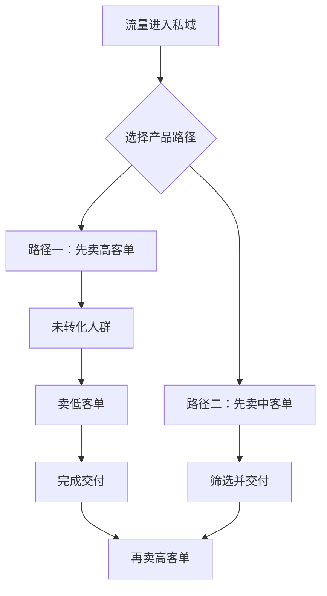

# 卖课的获客模式与转化模式大全

今天的内容主要想讲一下“卖课”这件事的获客模式和转化模式。这个话题源于 8 月 12 日解答韩老师直播问题后的一个灵感，当时答应要写一篇这样的内容，让大家了解现在都有哪些玩法可以选择，并结合自己的业务情况做参考。

 

今天，我来啦。

 

# 一、公域获客模式：先按客单价看

在公域这一块，我会从客单价出发，讲讲都有哪些模式。不同的单价、不同的平台，也有不同的玩法。

 

## 1. 零元获客：非合规导流与合规获客

“零元”其实分为两类：

1. 一种是官方不鼓励的，在官方认定中属于违规行为

 

1. 另外一种则是官方不违规、合法合规，属于官方扶持和支持的绿色通道

> 我下面把不合规的称之“导流”，合规的称之“获客”

 

| 平台 | 非合规导流 | 合规获客 | 常用工具 |
|-|-|-|-|
| **抖音** | 简介、主页、粉丝群、私信等方式留联系方式 | 蓝 V 预约组件、信息流留咨 | 本地推、AD 投放 |
| **视频号** | 评论区、简介、主页 @ 小号等方式留联系方式 | 短视频挂企业微信、直播间一键加企微 | 微信豆、ADQ |
| **小红书** | 账号名、主页、粉丝群、评论区等方式导流 | 信息流收集手机号、私信留资、引导加企微 | 聚光 |

### 抖音

#### 非合规导流

抖音的零元非合规导流，包括：在简介或主页发布微信号，通过粉丝群发布微信号或跳转链接，以及在私信中留手机号、微信号。这些都属于违规导流。

 

这种适合什么？

1. 要么是黑五类产品、灰产类目。
2. 要么是不太适合在公域直接做成交的，比如像高客单价的产品，需要在私域里面去聊、做顾问式成交、用朋友圈去养护去吸引，销售一对一跟进。

 

典型的，比如参哥、达达。

 

他们的内容矩阵做得非常非常好，但他们和博商不一样。

 

博商也是做内容矩阵，但博商是在公域直接转化——要么通过短视频挂车，要么直接开直播。

 

但他们不做“0 元粉”的导流。像达达、参哥这些商业博主，很多都采用 0 元导流。

 

1. 要么就是对于某些机构或 IP 来讲，擅长做内容，但是不擅长做公域成交。比如K12团队。

 

像 K12 团队有很多老师，其实一方面不愿意卖课，另一方面在公域也确实卖得不太好。但在公域如果涉及到成交，卖得不好又会影响流量。

 

所以有那么一波内容做得还不错的老师，比如在公域讲干货、讲知识、讲题，你会发现其实有很大的播放量和流量。但是挂车之后，变现效率和转化率非常低。

 

这种情况下，巨大的播放量其实可以通过粉丝群、私信等方式导流到微信，然后再去做成交。

 

这个模式对于纯老师、非销售型的主播或非销售型的老师 IP 来说，是非常适合的方式：你只需要在公域通过短视频或直播去讲专业知识就可以了。

#### 合规获客

第二个，我说一下抖音官方合规的“0 元获客”怎么做。

 

我把平台不支持的方式称为“导流”，把平台支持的方式称为“获客”。

 

抖音是有蓝 V 号的，蓝 V 号是可以支持挂预约组件的，这个预约组件它是可以留手机号码的。

 

当你刷到一条视频的时候，你会看到它左下角会有一个预约。比如说我是卖房子的，或者我是卖汽车的，当你看到之后呢，你点击左下角就会弹出来一个落地页或者一个表单，你就可以把你的信息、号码填上去。

 

填上去之后呢，我在抖音的蓝 V 号后台就可以收到了。收到之后呢，我就可以去联系客户了。

 

这个功能是蓝 V 号对应的权益。

 

现在平台在做内部调整，在慢慢地从过往的蓝 V 平台迁移到抖音来客平台。

 

事儿还是这么个事，功能也还是这个功能，只是它内部做了一个调整。如果有需要这个方式的，可以跟我讲，我可以帮你去看一看怎么去开通。

 

另外一个，上面我说的是免费的。就是你只要是蓝 V 号，你就有对应的功能，它这个功能本身是免费的。

 

但是如果你需要推广的话，就会涉及到信息流（也就是 AD 投放），比如你刷着一个视频，视频上显示着广告，你一点击广告就可以填写手机号，这就是 AD 广告投放。这种就是你要去投放才有流量、才有获客，不投放就没有流量。它不属于内容获客，它就是属于商业留咨。

 

如果是像我上面说的，蓝 V 账号加上左下角有预约组件，这种想用投放工具去增加曝光的话，是要用本地推来投放。

 

对于高客单价的行业来讲是比较适合的。你比如像教育赛道，教育类有加盟，还有留学，这些客单价都比较高。

 

因为客单价高，所以我们需要去获取、去留资，拿到客户的手机号，或者是直接加上微信。然后跟客户在微信或企业微信上沟通，根据客户的具体情况去做转化。

 

如果是投信息流广告（花钱买量）：

第一，客单价不用做得非常高，比如 2000、3000、4000 的都可以做。

 

但是，要么你得有很高的转化（进入私域后的转化率），要么产品本身得有复购或续费性质。

比如像 K12，假如是 3000 块钱一个学期的课：你的获客成本挺高，转化率也还行，首次转化的 ROI 比如说是 2，但其实并不怎么赚钱（因为刨去流量投放成本、员工及各种行政支出等其他成本之后，基本不怎么赚钱）。但正因为 K12 有续费属性，你就可以靠后期的续费来赚钱。

 

所以，你要想的是：要么做中客单，但产品有续费；要么直接做高客单；或者既有中客单，又有高客单可以升单。

 

### 视频号

接下来说视频号的 0 元方式。

 

因为作为内容平台，视频号和抖音也一样是有导流的。只要你有账号主页、有评论区什么的，这些都是导流的路径。

 

前面我说了，我把导流归称为“平台非支持的方式”。

 

像在评论区留微信号、在简介里留联系方式，以及在主页@小号，这些都是平台不支持的。视频号已经明确出台规定，说这些属于不合规的方式。

 

和抖音一样，优先这么干的一定是视频号不适合挂车，或者视频号不支持你售卖的类目。所以你没有办法，只能去引流到私域，因为私域管得没有视频号那么严。

 

另外就是我前面所说的“高客单”。高客单在公域不好成交，通常需要引流到私域。

 

如果说你是为了高客单在公域不好转化，去做这种导流方式的话，那也是可以平替的。毕竟直接导流不合规，有被处罚的风险，所以尽量还是用合规的方式，或者去提高客单价。

 

像视频号现在的商品，比如你定价 5 块钱走电商模式，它是支持导流的，至少获客是不违规的。而且 0 元、5 元和 9 元其实没差多少，相对来讲客户质量还会更精准一些。

 

不过唯一不同的是：

1. 0 元模式：完完全全靠内容。内容好流量就大，能导流的人就多

 

1. 电商挂车模式（短视频或直播）：一旦挂车，就需要兼顾两个流量池：

 

(a) 内容池的数据要跑得好

(b) 成交池（电商池）的数据也要跑得好

 

所以从 0 元变成低价课，对能力模型的要求就不一样了，多了一项电商成交的能力。

 

#### 合规获客

 

然后再说视频号合规的 0 元获客方式。

其中包括两大类：

 

第一大类是视频号短视频，左下角可以挂载企业微信。平台这么做，虽然不是强制投放，但如果你想稳定地获取更多流量，肯定还是希望你走投放。

背后的投放工具叫“微信豆”，是 5 月份刚出的新功能。相对来说，目前的获客成本还是蛮低的，好处在于完全合规。

 

但它的缺点在于：除非内容做得非常好，否则因为有蓝 V 标识，左下角又挂了企业微信，用户大概率一眼就能看出这是一条广告，数据可能就不会太好，也容易让大家误以为被限流了。实际上不是平台限流，而是挂上组件后，它本身就成了一条获客短视频。它的获客效率和客户精准度会更高一些。同时，为了获取更多精准客户，可以用微信豆加热，触达更多用户。看似投放多花了钱，实际上客户更精准之后，转化也会更高，整体反而可能赚得更多。

 

第二大类就是腾讯广告 ADQ 对应的投放方式。比如在朋友圈，或者在视频号的下方，你经常会看到带有“广告”两个字的广告。这种就是通过腾讯广告的 ADQ 投放工具来投的。

 

除了我刚才所说的朋友圈，以及视频号的视频下方，还有一个场景是直播间。

 

直播间也是可以直接做 0 元合规获客的，用 ADQ，前提是要用 ADQ，会弹出来一个小卡片，点击小卡片就可以一键添加企业微信。目前这个模式，就是在直播间用 ADQ 投放的行业，哪个用的最多呢？比如那种财经做股票的。

 

这个获客方式不限定于只能做股票，它支持多个类目。

 

具体的类目方面，它不是完全开放的，因为会涉及到一些资质问题（比如教育类目也可以做）。

 

如果有想走这个方式的，可以跟我说，我帮你对接服务商去评估一下是否符合。如果不符合的话，一般花钱也能办，就是需要加白名单。

 

### 小红书

小红书也一样，分为两大类：

 

1. 导流：我称之为违反平台规定的方式

 

1. 获客：也就是平台合规支持的方式

 

这三大平台所有 0 元导流的方式，无非都是账号名、主页、粉丝群和评论区，在小红书上面做零元导流的只有一种情况：就是不愿意花投放费用开聚光去豁免。说白了，就是不愿意给平台交广告费的。

 

那小红书合规获客的方式有什么？就是投聚光。投了聚光之后，你既可以投放信息流视频广告收集手机号，也可以通过私信发送手机号，以及引导添加企业微信（免除限制）。

 

## 2. 收费获客：三个价格档位

说完了 0 元的，我们接下来就说收费的。

 

收费一般分为三个档。每一档对应着一种获客模式，获客模式背后又对应着不同的转化模式。

 

| 档位 | 常见价格 | 产品形态 | 主要特点 |
|-|-|-|-|
| **低价课** | 9.9—99 元，多集中在 9.9—49 元 | 纯课程，或课程搭配书 | 主要承担引流和筛选作用 |
| **中价课** | 99 元以上，常见 199—399 元 | 相对完整的闭环课 | 通常采用轻交付，如 30 节视频课、较少重服务 |
| **正价课** | 相对于自身产品体系的高客单，常见 2000—3000 元以上 | 完整课程或核心产品 | 可在公域直接卖，也可由低价课、中价课在私域承接升单 |

### 低价课（9.9 元—99 元）

 

现在我们分平台来说一下第一档。

#### 抖音

目前的第一档（9.9 元到 99 元）基本上在抖音上被堵死了。我们这里说的付费，更多指电商付费的方式，也就是挂车的商品。

 

你比如像信息流投放，可以收费吗？也可以收 3 元、9 元、19.9 元，你也可以这样定价。但我们这里说的，更多指的是电商挂车的方式。

 

 

因为抖音现在限制了 150 元以下虚拟产品的解密，大家做低客单价，肯定是指望着引流到私域去升单、卖更高客单价，对吧？

你要卖更高客单价，肯定还要做二次转化动作，这就需要在私域里开 3 天公开课。开 3 天公开课就需要导课、促到课，还要跟销售对接、沟通。

 

如果直接在公域去卖正价课，你怎么去促到课、怎么去转化呢？难道用抖音私信聊？难道用抖音粉丝群来替代微信群吗？不可能的！

 

所以说，基本上 9.9 元到 99 元这种低价的虚拟商品，在抖音上已经被堵死了。

 

但是这里需要注意一点：这个价格区间（或者说 150 元以下）的客单价，在抖音上并没有被完全堵死。为什么呢？因为我刚才强调的是“虚拟商品”。如果你要做的客单价在 9.9 元到 150 元以下，只要不需要直接解密，也就是说挂实物商品，这依然是可行的。虚拟商品和实物商品唯一的区别就是在你下单的时候，一个只填手机号，一个要填地址。

 

一旦你走实物商品的话，客单价也一样。正如我前面所说的，也需要在私域里面做升单、做“低转高”的转化，去卖你的高价课。

 

但是卖了实物之后，又没有办法解密，就代表着转化率不会高到哪里去，也意味着会流失一部分用户。

 

那这种模型适合什么样的业务呢？就是适合低客单价的业务。比如我卖 9.9、19.9、29.9、49.9，本身我卖出这个产品的时候我就是不亏钱的，或者是我亏了很少很少很少的钱——比如说我就用 10 块钱、用 20 块钱获取了一个精准客户。

 

要达到这种结果，只有两种方式：

1. 自然流：不花广告投放费，也没有太多人力成本，主要靠主播一张嘴，顶多再加个运营。

 

1. 另一种方式：比如卖实物，最常见的就是书。除非你的书非常厉害，加上你的话术也厉害。你最后卖出来的是什么呢？你上了投放，但因为你的书很好、是个爆品，最后光靠卖书这个事，怎么都是不亏的，都是赚的。

 

所以这种情况也是可以的。

 

这也是为什么你会看到很多卖 19.9 元、卖 49.9 元的人，明明知道交付不了、加微率也高不了，但为什么他还能一天卖那么多单，而且干得那么好、活得好好的？

 

就是因为他更多主打的是书，做的是教育电商化、卖课电商化。他在前端就没让这个事亏掉，同时又获得了大量的付费用户。

 

当你获得了大量付费用户，其中有一小部分通过书上面的二维码成功加到你，这部分客户未来只要转化出正价课，你等于就是纯赚的。

 

所以这些模式的选择背后，是 ROI 的计算，是你利润的计算。不是应该不应该投放的问题，而是应该做虚拟产品，还是应该做实物产品？

 

#### 视频号

接下来说一下视频号。视频号在低价课这一块相对友好，这也是为什么我们会看到视频号上有大量的低价课。

 

它的书课包类型少很多（也就是让用户填地址的步骤会少一点），更多的是虚拟商品。因为视频号现在对于虚拟商品是可以直接解密的，不需要任何其他额外的资质和额外的 GMV 要求。（但不代表着这个红利会一直存在，因为在最开始的时候，视频号的实物商品在 2023 年也是可以拿到手机号的，但是现在实物也拿不到手机号了）

 

所以在视频号上，你会看到大量的 9.9 元三天公开直播课：9.9 元、19.9 元、29.9 元、39.9 元、49.9 元。

 

这个就不用说了：

 

1. 能解密，直接拿到手机号，加微率就有保障

 

1. 视频号客户的精准度（也就是后端转化率）确实比抖音更高，再加上视频号做好了成本其实也很低

 

你看，后端转化的客单价高，也代表着转化率会更高（因为没有浪费），前面的获客成本相对来说又没那么高，整体折合下来，利润就会高。

 

唯一不足的是，如果你是一个稍微大一点的团队，每天需要的获客量级非常大，那么视频号可能满足不了你。因为视频号现在的整体量级确实没有那么大。

 

 

倒不是说它的平台用户量不够，而是平台的商业化用户量没那么大。虽然它现在的平台商业化有所提升，但跟抖音相比还是差得太远了。

这也恰恰是抖音平台退款率高、转化率低的原因。

 

就是因为商业化太严重了嘛，大家容易被广告蛊惑、拐走，但很多人其实并不是那么需要。当他清醒过来的时候，自然就不会再买你更高客单价的东西，也就会退掉原来在公域上买的商品。

 

#### 小红书

最后说一下小红书。小红书蛮有意思的：

 

第一，小红书正在大力推电商化。小红书过往更多是以种草和商业广告为主，在电商挂车这块确实起步没那么早，做得也没那么好，所以它现在也在极力推电商。

 

它的电商挂车有一个好处：客单价相对来讲会更低。比如前面讲的 0 元是不合规的，但小红书有一个 1 毛钱的商品机制，它的电商教育产品最低价格可以挂到 1 毛钱。

 

1 毛钱基本上就等于没怎么付费，对客户来讲就掏了 1 毛钱，但它是完全合规的，而且在后台可以直接拿到客户的真实手机号。

 

所以，如果说你在小红书上面内容做得好的话，而你又不愿意去投聚光，那我建议你可以把你的笔记（不管是图文笔记还是视频笔记），尽可能地去挂上一个 0.1 元或者 1 元的“车”，以此稍微筛选一下客户，再以合规的方式引流到私域，可以适当根据你的营收情况，去投少量的一些聚光也好，或者叫乘风也好，来让你的获客量增加一些。

就是不要完全只靠自然流，除非你真的自然流吃得很饱。

 

### 中价课（一般 99 元以上）

接下来我们来说一下中价课。

 

中价课和低价课，现在说实话已经没有太大的区别了。

 

为什么？因为现在已经 2026 年了：

 

1. 钱越来越难赚：公域的转化率以及公域的投放 ROI 越来越低了。

 

1. 大家越来越清楚要做私域：在公域做中价课的这部分人，目前基本上多多少少也都开始做私域的升单了

 

因为在过往的时候，很多在抖音、视频号上卖课卖得好的，大部分都是过往没有卖过课的，或者是之前在机构、团队里面卖课没弄好的人。他就是偶尔做个短视频、做个自媒体，然后发现做好了。

 

以及有很多 MCN（教育 MCN 或者知识付费 MCN）直接怼到这个赛道了，去批量产出内容，练表达、筛选合适的人，包括这里面也存在很多演员。

 

但是自从 23 年、24 年开始，大厂在做抖音、视频号这事上面，慢慢开始真的会做了。以前粉丝量老多，但是变现做得不好，因为没有外面的人会研究，只会花钱，做出来的数据和利润都不行。

 

现在做公域投放又不怎么赚钱，只能靠私域赚钱，所以大家也都去做升单了。你不管现在在公域里面做自然流还是做付费流的，去看看就会发现，10 个里面有 9 个后面都有升单产品：不赚钱的想通过私域赚，赚钱的想通过私域赚更多。

 

关于中客单价的课程（中价课），在抖、视、红三个平台上其实没有特别大的差异。

 

唯一的差异还是在“解密”这个问题上。因为做这个事情需要引流到私域、在私域升单，拿不到手机号是不行的。

 

所以在抖音上，要想做解密，就得走虚拟产品路径，并且要走抖音目前的定向邀请。定向邀请之后，还要符合读书卡的资质。也就是说，抖音会在卖课这件事上卡你一下，虚拟品会卡你一下，实物品也会卡你一下。

 

因为都需要定向邀请。

 

如果是之前干过、本身有这个类目和资质的人，那就可以正常弄。

 

如果没有资质，但听我讲了之后，你觉得想在抖音上做这种付费课（不管低价课、中价课还是高价课），那你可以跟我讲，我帮你去对接能解决这个问题的人。

 

#### 三个平台的解密规则对比

关于这个事，各平台的规则如下：

| 平台 | 虚拟商品 | 实物商品 | 原文判断 |
|-|-|-|-|
| **抖音** | 有限制 | 有限制 | 两道都会卡，需要定向邀请及相关资质 |
| **视频号** | 相对开放 | 有限制 | 实物商品卡，虚拟商品目前不卡 |
| **小红书** | 相对开放 | 相对开放 | 两种类型目前都可以拿到手机号 |

#### 投放差异与平台选择

我们再说一下中客单价的另一个区别，就是投放。

 

因为中客单价说实话，你但凡要卖两三百块钱，一旦上了三位数就挺难卖的。如果做自然流，你是小本经营、超级个体，持续出单卖一卖也没啥问题。

 

但大部分人估计都得上投放，这就涉及到投放的退款率和 ROI 问题：

 

 

1. 公域盈利难度极高：

抖音的算法已经非常成熟了，在 ROI 这一块，基本上在公域不可能让你直接挣到钱。不是说每个人都赚不了，而是有这么一个规律：如果你没有极强的内容，全靠百分之百纯投流，既没有自然流和老粉占比，也没有短视频引流，那想靠纯投放去搞 ROI 2、搞 ROI 3 直接在公域赚钱，是非常非常难的。

 

1. 投放掺水严重拉高退款率：

 

抖音的投放掺水极其严重。平台本身的性质就会增加退款率，再加上一些假粉、假订单等掺水问题，会让退款率变得更高。退款率一高，利润不就更低了吗？

 

所以这是抖音的问题。

 

抖音对应的优势确实是量大，量大的话可以薄利多销。但你也要清楚，如果真有那么多量进来了，你能不能承接得住？账到底该怎么算？

 

这也是一个问题。

 

视频号这一块相对来讲，因为有微信的加持，有“短视频预约到直播间”强提醒的一个作用，所以转化率可能会比抖音高一点（包括直播间的转化率）。

 

目前相对来讲，投放的 ROI 可能也会比抖音好一点。当然，前提是你得会投，以及内容和节奏也都要 OK。

 

我觉得做中客单价，如果你不是需要特别大的量，建议把小红书和视频号作为两个主平台。

 

原因有三点：

 

 

1. 卖课资质的问题很好解决，可以直接卖
2. 只要正儿八经做内容、有稳定的量，就会有稳定的出单

 

1. 如果你想通过上一些微付费，ROI 也会不错，既能保证量和利润，又有后置的升单产品，这样就会有更多客户可以被升单

 

加上小红书还有一个天然优势：现在实物商品也能拿到手机号。所以你不用纠结走虚拟商品还是实物商品，想走哪个就走哪个。

 

### 正价课

 

最后我们来说一下正价课。

首先，卖正价课本身就是一个门槛非常高的事情。你想在直播间里直接把这么贵的一个商品卖出去，难度极大。

 

它一般分为两种方式：一种是通过自然流去卖，一种是通过付费流去卖。

 

你要是完全靠自然流来卖，不仅需要极大的流量，还得能在直播间里把两三千块钱客单价的转化做出来，这种情况极其少见。

 

K12 领域有个博主就是这么干的，但他的模式完全不可复制，你只能感叹一句他确实厉害，跟其他人没什么参考关系。这个博主叫“天天讲文学”，他在 24 年 9 月份爆了那个系列的视频之后，直播间从之前一天只有几万块钱收入，直接蹦到平均每天能达到 30 万以上（通常是一上午直播卖两场），最高的一天甚至卖了 140 万、700 多单客单价 1980。

 

然后其他你在公域平台上（也就是那三个平台上）看到的，卖这种正价课的其实也有不少，但大部分你可能看到的还是教培行业，像知识付费卖正价课的还是比较少。

 

 

除非是什么呢？除非是你这个类目或你这个行业，它要么就是有天然的刚需，要么就是你这个用户的购买力就很强。

但是你别说信任这个事，信任在公域直播间，要么就是你每天在公域上面做的内容又很好，然后内容又是新鲜的、讲的是不一样的。你积累了很多的忠实粉，他们已经足够在公域去滚动、去买正价课了。

 

虽然每天直播间里都在卖正价课，但如果做一下统计，你会发现这些客户往往是十天或半个月前关注你，之后每天持续看你，过了十来天才买。今天刚来、今天就买的情况很少，因为信任的建立真的需要时间和过程。

 

#### 判断高客单是否适合：需求、信任、购买力

就是我前面说的：需求、信任、购买力，这三个也是转化的要素。所以对于高客单，就要研究一下这三个要素，看你的类目和你是否匹配、是否符合。

 

有的时候在直播间看到两个人一起联合在卖的正价课，那种数据不具备参考性。

 

因为那是集中一次，你可以理解为那是发售。它是把好久的量集中在这一次去打，以及也有拿投放来砸。

 

#### 直接卖正价课的好处

前面更多说的是困难，也就是高客单价的正价课直接卖确实不太好卖。接下来说说这么做的好处在哪里。

 

好处在于：它真的不需要你搭建太多的团队。

 

假如你是一个超级个体，挺能吃苦，也能坚持。你每天在公域直播两场（上午一场、下午一场），每场直播 2 小时，一天工作 4 小时。

 

当你开播 30 天、足够滚动起来并开始有了客户积累之后，如果能稳定在每一场卖出一个客单价 2499 元（或 2500 元）的产品，那你一天的收入就是 5000 元。

 

#### 一个超级个体的收入模型（示例）

我们按一个月 22 个工作日来算：

| 项目 | 示例测算 | 说明 |
|-|-|-|
| **月总收入** | 5000 元/天 × 22 天 = 11 万元 | 每天两场直播，每场成交 1 单约 2500 元的产品 |
| **退费后收入** | 约 10 万元 | 示例按退费扣除 1 万元计算 |
| **省去的成本** | 私域运营和销售承接成本较低 | 无需把流量引到私域再沟通、转化；自己或助理完成交付 |
| **最终净利润** | 约 5 万元 | 示例按再扣除 5 万元综合开销计算，其中包含微付费推广和协助人员薪资 |

在外面哪里上班，一个月能稳稳挣 5 万块钱？

 

这还没算后续的续费和升单。如果你这个课还有续费和升单，后面就全是额外赚的。假如你 10 万块钱的客户里，续费率能达到 80%，那你还能多出 8 万块钱的收入。

 

 

你每个月都这么干，一年下来年入百万基本没什么问题。前提是，前期的启动和见效反馈可能会慢一点，需要熬过最开始的阶段。很多过往公立学校的老师，或者其他机构出来的老师，现在都在这么干，而且赚得还不少。

这个就无关乎具体是哪三个平台了，哪个平台都可以，你能把哪个平台干起来哪个平台都行。

 

而且到这里就是三合一、甚至四合一了：每个平台同时直播，同时做短视频，同时去转化。因为你多一个平台，就可能多出来一个客户、多出一笔收入。

 

只不过它背后需要你的设备扛得住，可能需要用一台台式电脑、用 OBS，解决好三个平台同时开播的技术问题。

 

## 3. 选路线：主路径跑稳，再试探第二条

以上是我们所说的，目前在卖课这件事上，三个平台主流的 0 元、低价课、中价课、高价课四类获客玩法。

你可以去看看： 

1. 你未来想走哪一条路？
2. 或者你现在正在跑的是哪一条路？
3. 你想转到哪一条路？
4. 或者你想新增哪一条路？

ei wen

为什么我这里列了四项，问你想转哪条路，或者你想新增哪条路？

 

因为我跟你讲，没有任何一条路是足够稳的。你在走稳一条路的时候，如果能稍微试探一下一条新的路，就去试探一下。

为啥呢？因为如果试探得好，你可能两条路同时并行；退而求其次，当你现在这条路不稳的时候，你也可以直接转型到下一条路上去，因为你现在做自媒体就是靠着平台：平台给你流量、让你好，你才能好；平台不让你好，你就好不了。

 

# 二、私域转化模式

## 1. 两类转化：IP 或讲师参与与否

在私域转化中，其实分为两大类。这两大类不是指“低转高”的直播公开课，也不是电销、网销或发售这些具体模式，而是指：

 

1. 有IP或者讲师参与的转化
2. 没有IP或者讲师参与的转化

 

因为到了私域之后，在转化方式上面其实没有太多花哨的玩法，它更多的是什么呢？更多的是细节上面的玩法，也就是颗粒度上面的玩法。

 

## 2. 三种常见转化形式

目前市面上主流的是前面所说的第一类，也就是有 IP 或讲师参与的转化，对应的方式大部分也是“低转高”的私域直播公开课。

 

| 形式 | 谁主导 | 收入节奏 | 特点 |
|-|-|-|-|
| **电销** | 销售主导，通常没有 IP 参与 | 日销或持续收入 | 依靠销售跟进和一对一沟通 |
| **发售** | IP 或讲师主导，有销售更好 | 节点性、周期性 | 几个月集中做一次，单次收入可能较大 |
| **网销（公开课）** | IP 或讲师为主，销售为辅 | 日销、周销 | 以私域直播公开课完成集中养粉和成交 |

像电销和网销，基本上每天或每周都有收入。

 

但像发售则是节点性、周期性的，几个月搞一次，搞一次就会有大的收入。其他时候可能有一些遗留的客户来咨询，收一点小钱。

 

## 3. 五种私域成交派系

### 朋友圈成交

会伴随着一对一和社群。像社群更多，比如说会建一个那样的一个思考群，就是拿着内容去洗粉、去养护。

 

然后在朋友圈发案例、效果、自己的生活和专业。这种做爆款单的会比较多。当然，这种主要卖的也是“人”——更多的是卖人设。就是你朋友圈看多了，蛮喜欢他，或者被他打动、吸引了，想成为他。

 

这种一般女性的 IP 做的比较多，因为确实女性相对来讲朋友圈做的都比较好。

 

### 社群成交

现在纯社群成交的很少很少。因为光靠在社群里面发消息，去卖高客单价的产品是很困难的，通常都需要借助朋友圈、一对一私聊以及私域直播。

 

如果是卖低价课的话，在社群里面卖会更合适一点。比如在圈子或社群里面，去发一个 9.9 元的福利课，以此来清洗、筛选出精准的意向客户。

 

### 一对一成交

这种是高客单的业务（比如留学），需要一对一去跟进、一对一去提供咨询服务，先了解清楚情况，然后根据情况推荐方案。

 

### 直播成交

这个直播成交派系，更多指的是私域的“低转高”直播公开课。

 

当然，也有一部分是在私域里面，通过朋友圈和社群去养护、去交付，最后卖课的时候再推到公域直播间，这也是一种类型。

 

但最常见的还是私域“低转高”的公开课，原因有两点：

 

1. 在私域做直播，相对来讲留存率会更高、更长一点。
2. 现在的私域直播工具确实越来越成熟，可以做“伪直播”，这样大大提升了效率，不用每一次开课都去真人直播。
3. 加上“低转高”的模型在市面上也非常成熟，这方面的人才储备也比较多。

 

### 线下成交

线下成交也分两种： 

1. 一种是从公域导流过来之后，直接引到线下成交
2. 另外一种是先卖线上课，卖完线上课之后，再去卖线下课

 

这种模式在商业、疗愈领域会比较多一些。K12 目前说实话还是比较少，因为 K12 的主要学习者是孩子。虽然会有一些冬令营、夏令营，但日常线下课几乎没有。不过，对于 K12 相关的人群，也就是做家庭教育的妈妈们，会有人参加线下课。所以说，现在家庭教育确实也在慢慢变成商业类。

 

## 4. 为什么建议搭配私域直播公开课

这里我可以先说一下：不管哪一种成交派系，其实都建议搭配私域的“低转高”直播公开课。无非是公开课的开设频次，以及营销的力度和节奏，需要有针对性地调整。

 

因为它本身直播就是为了两个方面：

1. 为了集中成交
2. 成交前集中的养粉

 

你在私域里多开几场直播，跟用户多做一些互动，多给一些价值，再去卖的时候，肯定会增加转化率。

 

包括做线下、做实体同城的那些，都可以做私域直播。哪怕你在私域直播里不卖东西，光是唠嗑都能增加粘性。

 

比如实体门店也可以做私域直播卖团购，对吧？公域可以做，私域也可以做。现在很多实体老板都在做私域，公域是用来拉新的，而私域直播就是用来做激活和复购的呀。

 

## 5. 两种产品转化路径

对于私域转化，有两种产品逻辑。

 

**第一种：**直接卖高客单。高客单卖完之后，针对没转化的这部分人，再去卖低客单；卖完低客单之后做交付，然后再卖回高客单，形成 V 字形路径。

 

**第二种：**先卖中客单，筛选出一部分人做交付，然后再卖高客单。

 

这里的“中”和“高”，不是价格意义上的“中”和“高”，而是指你自己的产品体系中的“中”和“高”。

 

## 6. 三层产品体系

大部分正常的产品体系主要有三层：

| 产品层级 | 作用 | 典型形态 |
|-|-|-|
| **引流品** | 用来引流和筛选精准用户 | 公域低价课或中价课 |
| **主力品** | 大批量销售，承接引流品 | 通常是上千元的核心产品 |
| **形象品** | 拉高产品体系上限，承接升单 | 自身产品体系里客单价最高的产品 |

主力品里面如果有多个品也是可以分层的，比如分两层，两个产品价格一般不超过 10 倍。

 

## 7. 私域直播公开课如何承接不同引流品

关于转化模式这一块，还是主要推荐私域直播公开课。因为想要做好私域直播公开课，同时需要把朋友圈、社群、一对一都做好，包括电销、网销也都要做好。

 

只不过是根据前面的引流品性质不同，后面的私域直播公开课定位就不同。

比如前面的引流品就是卖的三天直播公开课，那这个三天的公开课，它就是你正价课的一个体验款。

 

如果说你前面卖的是一个中价课，那这个中价课也有两种类型：

 

1. 第一种是价格为中价的体验款，只是比低价卖的客单价贵一些而已

 

1. 第二种是卖 A 品（引流品是 A 品），但实际上在私域里面要卖 B 品，而这三天的直播公开课就是为了卖 B 品，所以这个私域公开课的内容，就要是 B 品的体验课。

 

这里面在转化的时候就会有一个问题：因为这些人大部分都是为了买 A 品来的，其中有些人可能有 B 品的需求，有些人可能没有。

 

你为了要卖好 B 品，就必须去对买了 A 品的人，做好 B 品需求的铺垫、引入和塑造，才会有更多的人去参加 B 品的体验课，进而去购买 B 品正价课。

### 中价课的一种特殊形态：正价课分段或月卡

这里单独说一下，中价课里面还有一种特殊的存在：卖的就是正价课，只不过价格是正价课的十分之一或五分之一。它不是体验款，你可以理解为分期：分 12 期、6 期，或者先买其中 1 期。

 

我买的就是你从头到尾的完整课程。买了之后，学到的内容、对应的顺序和服务，都和全款买的人一样，只不过我买的只是其中的第一段。

 

但体验课不是这样。体验课是从整个课程里挑出几个点，单纯把这几个点翻来覆去讲，其实并没有多少干货内容，更多只是为了让你觉得爽了去买。

 

而这个是真真正正买了正价课，只不过是先交了一小部分的钱，先来感受一下你正式课程的价值和服务。

 

常见的就是月卡的模式。

 

这种情况下，一般月卡客单价也会上百。如果上百的话，在公域去走投放，相对来讲 ROI 就会有保证，大概率不会亏。

 

只要能保证不亏，你至少就能确保获取来、进到私域的用户，都是没有让你亏损的。这相当于让你没花任何流量成本，就获取到了后续还可以持续升单的精准用户。

 

### 正价课的续费与升单

对于纯正价课用户来讲，进到私域其实就是为了续费或直接升单。但前提是你真的要把正价课做好交付。

 

对于正价课续费和升单的转化，里面其实有一个误区：大部分人可能会在正价课结束之后，再让他去买、去续费或升单。但实际上，在学到一半的时候就要让他去续费，在 K12 里面一般称之为“期中续费”；学完之后则是“期末续费”。在成人业务里面，也可以称之为半程续费、全程续费。

# 三、补充平台：

最后加一个补充，这个补充是关于 B 站和百度的。

**对于 B 站**，目前初高中生（尤其是高中生）是一个可以作为专门触达的渠道。

因为大部分的 K12 业务都针对的是家长，但是目前的高中生很多都玩 B 站，甚至很多初三的学生也玩。所以 B 站现在是一些主要针对学生群体的高中机构的必选之地。高途过往一直面对的都是家长群体，这两年也开始去 B 站上抢用户了。

而且 B 站的主页上是可以增加企微的获客助手，直接跳转的。

如果你的用户群体在 B 站上，那你也可以做B站。

**对于百度，**大家可能都不知道这个平台它还有直播。但其实百度直播有几个很明显的优势：

1. 转化率高：很多人看直播最初是来百度搜东西，搜到了对应的直播。它是搜索属性而不是被动推荐，搜索的转化率要大于推荐
2. 支持 24 小时数字人直播：而且百度数字人直播的技术还原度非常非常高，如果做真人录播也比其他平台松很多。

如果是走付费投放的，应该就知道，一场直播连续性的时长越高，相对来讲，这个投放的消耗利用效率就越高，那对应的 ROI 就越高。

---

# 四、相关阅读

和本内容相关的阅读列表如下：

