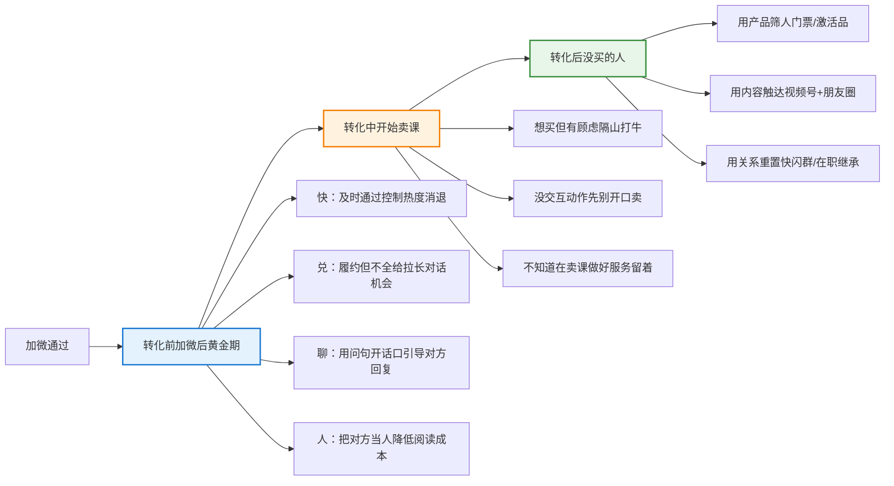
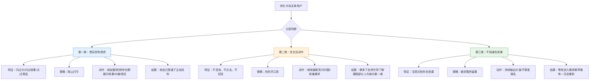
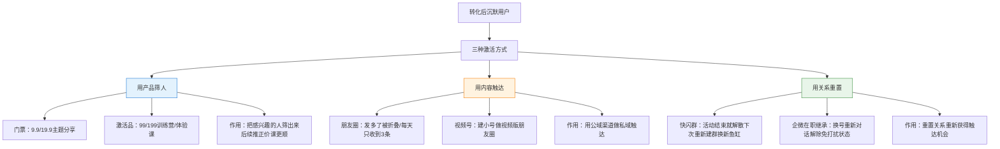

# 加了微信但不说话？从加好友那一刻就开始的激活体系

 知识库跳转链接

**石董会深度分享系列（按时间排序）**
8/20 [低转高公开课到课率提升](https://my.feishu.cn/wiki/HiqYwwTwTi8bj6knCGHcperJn9f)
8/24 [卖课的获客模式与转化模式](https://my.feishu.cn/wiki/CGEVwfXZVipMtikSqgGcgJc1nKb)
8/31 [公域获客模式的选择和钩子的设计](https://my.feishu.cn/wiki/VSE7w3AooiqGLVkD5YBcHBokndd)
9/7 [公域&私域工具系统全流程解决方案](https://my.feishu.cn/wiki/Wjdfwa1EciLxL1k2Sr4ccYvdn9g)
9/14 [十字诀·2026知识IP增长破局之道](https://my.feishu.cn/wiki/QjopwukixinMi6kcSgLcodrCntu)
9/21 **本文：从加好友那一刻就开始的激活体系**

## 背景描述

本周的“每周一刻”内容是写关于在私域如何促活、激活沉默客户的话题。

这个话题可能并不是大家会直接特别关心的，但它恰恰是最容易被忽略的一个问题。因为大家往往更关心私域的转化率和拉新问题，而大部分人其实都没有意识到：如果不去关注那些沉默的用户、不想办法去激活他们，就会浪费大量的客户资源。所以，我们既要继续拉新，也要把客户的利用效率做到最大。

所以接下来，我就跟大家讲一下，在私域用户激活这个问题上，我的方法论和策略是什么。

常见的问题和描述一般都是：

公域引流来了不少人，加了微信，通过了好友申请，然后……就没有然后了。

你发消息他不回，你发朋友圈他不看，你开公开课他不来。过了一两个月，你翻通讯录，看到一堆头像，根本想不起来这是谁、当时怎么加的。

大部分人管这个叫"沉默用户"，然后想着——等我做个活动、搞个训练营，再把他们捞回来。

但我今天想跟大家说一个可能跟大家想的不一样的观点：

**激活这件事，不是加了很久之后才做的事。从你"通过好友✅"那一刻，激活就已经开始了。**

你加好友之后每多拖一天、每多错一步，这个人就离你远一步。等到他彻底沉默了你再去捞，成本是十倍、二十倍。

所以我把整个激活按"转化"这个关键动作切成三段：**转化前、转化中、转化后**。每一段都要做激活，环环相扣，不是等沉默了才想起这件事。

---

## 一、转化前：加微后的黄金窗口期

我们现在做私域，都是采用加好友的承接方式，不像前几年做公众号时代时先进群再分流加微。直接加好友效率最高，但也意味着——**加完微信的第一波动作，决定了这个人后续会不会跟你说话。**

转化前激活的核心就两件事：**让更多人开口，并且有效开口。**

在讲方法之前，先想清楚一个前提：对方为什么加你？

如果他是冲着你公域放的钩子来的——免费资料、测评、低价课——那他加你是有明确目的的。你接下来所有的动作，都要围绕"他当初为什么来"这件事，不能跑偏。

基于这个前提，加微后的前几步，我总结为四个要素：

### 第一个字：快（及时通过）

这个不用多讲，但很多人做不到。

对方在公域看到你的内容、被你的话术打动、下单或者领资料，那一刻他是有热度的。你通过好友申请越快，这个热度越能接住。拖个半天一天，他那股劲就过去了，后面你再说什么都没劲。

及时通过的下限，是专业度和体验感；上限，是**控制热度消退**。不是说半夜也要爬起来通过，而是正常工作时间里，别让人家等太久。

### 第二个字：兑（履约但不全给）

公域说给资料，加进来就给资料；公域说送测评，加进来就送测评。前后一致，这是基础信任。

但注意——**履约不是把东西一次性全甩过去。** 很多人资料粉领完资料就消失了，为什么？因为你把该给的一下子给完了，你的作用就结束了，他没有理由再跟你说话。

正确的做法是：认这个事，提这个事，但把控节奏。资料可以分几次给，测评可以引导他先填再解读。把履约的动作拉长，对话的机会就多了，探需求、做铺垫的空间也就有了。

### 第三个字：聊（用问句开话口）

你把自己当成客户，把对话框从上到下滑一遍——是不是你一直在发陈述句、发通知，对方根本没有回复的理由？

"资料已经发你了，注意查收。" 这种话，对方看一眼就完了，为什么要回你？

但如果你换一种说法："我今天发得有点多，不知道能不能发出去，你收到了跟我说一声，我就放心了或者简单一句话，我发的资料能正常打开吗？" 这就是一个问句，对方回复的成本极低，大概率会回你一句"收到了"。

**每一次沟通都要给对方一个回话的口子。** 这个口子开了，你才能继续往下探需求、做铺垫。别每次都像发通知一样，发完就结束了。

还有一点——别让人家一眼看出你是群发。你可以群发，但话术别太"模板化"。人家一看满屏都是同样的话，本能反应就是"群发的我不回"。

### 第四个字：人（把对方当人，把自己也当人）

很多时候人家不回你，不是因为不想理你，是因为不知道怎么回你。

你大半夜发一大段话，人家第二天早上看到，压力多大？你一件事分三段发，人家翻半天才看完，阅读成本多高？

站在对方的角度把事情说清楚，让他愿意接你的话。你平时怎么跟一个你尊敬的朋友说话，就怎么跟客户说话。别哐哐哐一直发，也别写小作文。

这四件事做到位，你的回复率、到课率、第一次转化，都会有明显提升。

补充：

目前大部分的团队都是用自动化工具去承接，所以回复的速度很快，包括非工作时间也能第一时间通过好友并自动发送欢迎语。

这种情况，软件工具是帮我们解决不在线的时候替代我们去迎接对方，但它不能成为一种冰冷的东西，所以有的时候“打明牌”反而是最好的。

给大家看一个案例，这个不需要太多技巧，就是把事儿说清楚。自动回复就是自动回复，在线就是在线，没在线就是没在线。

这个企业微信背后的成年人绝对不会是 Lisa。但是这句话说完之后，你就感觉就是她似的，因为她直接把重点告诉你，重点转移到这是一条自动回复了，所以你会觉得：这真的就是 Lisa。

---

## 二、转化中：开始卖课了，怎么分层激活

转化前激活是相对容易的，因为你还没开始卖，大家对你还有服务预期。但一旦你开始推课、开始转化，情况就不一样了。

这个阶段，没买单的人不是铁板一块，我把他们分成三类，每类的激活策略完全不同：

### 第一类：想买，但有顾虑

这种人你能看出来——他问过价格、问过效果、点过商品、跟你聊过课程内容，但就是没付款。

对这种人，策略是**"隔山打牛"**。

别追着他问"考虑得怎么样了"，那样压力太大。你要做的是：把他可能有的顾虑，放到他能看到的地方——朋友圈、视频号、社群、甚至私信。

顾虑无非就那么几种：效果好不好？值不值这个价？靠不靠谱？你围绕这三个问题做内容展示，让他自己看到、自己说服自己。他想通了，会主动来找你。

### 第二类：没任何动作，既不咨询也不买

这种人你还没进入他的"买课视野"，他可能都没意识到你在卖课。

策略是**"先别开口卖"**。继续做服务、继续问问题、继续收集他的需求。让他先跳出来跟你对话，聊多了，再自然地引导他了解课程、去听公开课。聊完之后，这里面会有一部分人变成第一类——想买但有顾虑，那就回到上面的策略。

### 第三类：压根不知道你在卖课

这种人最简单，也最需要耐心。别追着他群发报名信息，那样只会把他仅有的一点信任也耗光。

你就做好服务、持续输出价值。他现在忙、现在不需要，不代表以后不需要。你只要一直出现在他的朋友圈、他的视野里，早晚有一天他会看到、会感兴趣。你要做的就是别把他吓跑，留着他，等他进入需求期。

**转化中做激活，核心目的不是"让更多人回复你"，而是让合适的人进入转化环节，不合适的人留下来以后再转化。** 不符合的别直接删，留着，后面还有机会。

---

## 三、转化后：没买的人，怎么二次捞回来

第一次转化完，不管结果如何，总有一大批人没买。这批人不是没用了，而是需要用新的方式再激活。

常用的有效方式有这么几种：

### 用产品筛人

比如每月做一次9.9或19.9的主题分享，收个门票。这一步不是为了赚这个门票钱，而是把"对你感兴趣的人"从沉默人群里筛出来。他愿意花这个钱，说明他对你的内容是有需求的，后续再推正价产品就顺理成章。

比门票再重一点的，是轻量级的中客单产品——也就是我们说的"激活品"。比如99、199的训练营、体验课。这种产品有交互、有交付，用户在参与过程中跟你建立了更多信任，后面转化正价课的效率会高很多。

### 用内容触达

朋友圈现在有两个bug：个微发多了被折叠，企微每人每天只能收到3条。所以别把鸡蛋全放在朋友圈里。

我自己的做法是：建一个小号，专门做"视频版朋友圈"。每天发5条视频号内容，一边转发到朋友圈，一边靠视频号的推荐机制触达粉丝。等于用公域的渠道，做私域的触达。

### 用关系重置

这个很多人不知道，但特别有效。

第一次转化建的群，发了一堆消息，大概率已经被屏蔽了。这个群的使命就结束了，别把它变成一个没人看的"养鱼群"。

正确做法是：活动结束就解散，下次活动重新建群。就像养鱼一样——从一个鱼缸换到另一个鱼缸，新群有新群的热度，老成员进来之后会重新感知到你。你一直让他在最开始的群里泡着，发什么他都看不见。

还有一个更狠的方式：**企微在职继承。**

做低转高的人都知道，销售一天发十几条消息是常事，客户烦了直接给你设免打扰。一旦被设免打扰，后面发什么他都看不见了。

怎么破？用企微的在职继承功能，把这个客户的对话转移到另一个销售号上。相当于他重新加了你一次好友，免打扰自动解除，状态变回初始状态。这时候你再发消息，他看到的概率就大很多。

---

## 最后总结一下

激活这件事，我今天讲了转化前、转化中、转化后三个阶段。但我最想强调的其实是一个观念：

**别等用户沉默了才想起激活。从他点下"添加好友"那一刻，你就在做激活了。**

每多拖一天、每多错一步，就多流失一批人。你以为激活是"补救动作"，其实它是贯穿整个私域链路的"日常动作"——加微时激活、转化中激活、转化后还要再激活。

不是等出了问题才去解决，而是从一开始就把激活设计进每一个环节里。

去年刘思毅跟我讲，他说我是一个策略专家。我想想，的确是这样子的。不管是在问题的应对上面，还是在业务的设计上面，都是通过策略入手去优化解决。
咱们石董会的朋友们，在激活这个环节上或者其他的业务问题上，如果你们有遇到困惑，想不通的也好，或者想讨论也好，随时找我交流。
2026 年 9 月 21 日
石更新
