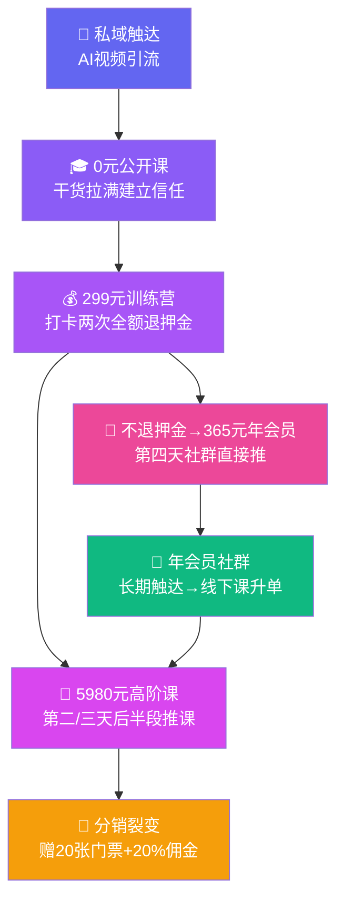

# 一个丝滑的转化模式：内容运营型销售的最佳实践

分享一个让我印象很深的转化案例。

对方从 **0 元公开课 → 299 押金 → 5980 高客单课**，一路丝滑升单，最后还顺手用 365 元年会员把没转化的流量兜住了。

整个链路没有一点强推感，全靠**内容运营型销售**在驱动。

我把这个路径详细拆解成了**五步漏斗 + 四个关键**，后半段的核心逻辑包括：

- 她为什么没直接退押金？
- 那个「365 钩子」到底怎么用的？
- 整个排品的公式是什么？

详情如下 👇

---

#### 一句话总结
不是短平快的收割逻辑，而是用**交付建立信任、机制引导转化、社群实现留存**，为线下课升单做铺垫的**长期主义打法**。

前几天收到一条私域触达，讲AI做图的。虽然这部分我已比较熟悉，但以我对这位讲师的了解，她的分享一定有不一样的视角，于是进了群。

今天想聊的**不是她讲的内容**，而是那套丝滑的、健康的转化模式。

---

# 📋 转化路径拆解（5步递进）

#### 0元公开课引流
低门槛触达，以干货内容建立第一层信任。
内容质量本身就是最好的钩子。

#### 讲义过硬，建立信任
公开课不讲废话，干货拉满。
真交付带来真信任。

#### 推出训练营 · 押金299元
3天AI商业获客训练营，打卡两次复盘即可全额退押金。
💡 用押金机制促到课，而非直接卖课。

#### 推高阶课 · 7980→5980元
训练营第二、三天后半段推正价课。赠20张299元课程门票（可转送），分销享20%佣金。
💡 先推高客单，门票和佣金放大裂变效应。

#### 退一步推会员 · 365元/年
第四天不在直播间卖，直接在社群推年会员：**押金不退即可补差价加入**。
💡 不选退押金 = 变相购买。退一步收拢未转化用户，为线下课升单铺路。

---

#### 核心排品逻辑：先转大 → 再推小 → 再转大
高客单转化后，对剩余用户用"押金不退即入会员"的机制做第二层收割，同时通过年会员社群建立长期触达，为后续线下课升单做铺垫。

---

# 🧠 为什么这个模式值得学习

| # | 要点 | 拆解 |
|-|-|-|
| **①** | **押金替代直接卖课** | 把299设计成押金而非付费课程，降低心理门槛的同时确保到课率。到课才有转化可能。 |
| **②** | **"先转大再推小"的排品节奏** | 高客单用户先转化，剩余用户通过"不退押金补差价"自然流入365元年会员，不留死角。 |
| **③** | **真交付 → 真需求 → 真付款** | 每一步都是实打实的内容交付，学员因真正学到东西而产生真实需求，**拒绝冲动消费**。 |
| **④** | **适合大多数团队复制** | 对非强转化属性的讲师和团队，内容驱动信任 + 机制引导转化的模式，是最健康、可持续的解法。 |

---

#### 惊喜补充：AI视频到课触达

#### 我最开始加他们微信后发送的到课视频是AI制作的，**我觉得很有意思，对于到课率和认可度很有帮助。**
技术门槛不高，难的是创意和用心——让用户第一眼就感受到"跟别人不一样"。

---

# 📈 转化漏斗总览

---

#### 这种模式属于**内容运营型销售**，对于大部分非强转化的讲师和团队来说，是最适合的方式。

---

点击查看我的详细介绍
